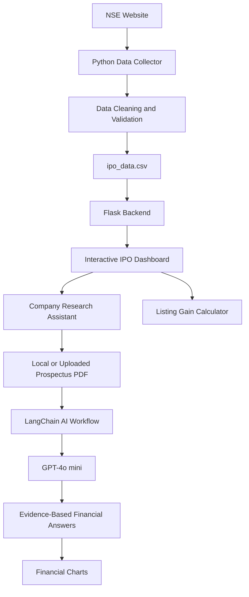

# FinAgent IQ 🧠📈
### LangChain-Powered Agentic AI for IPO Research & Financial Intelligence

FinAgent IQ is an AI-powered IPO research and financial intelligence platform designed to streamline IPO data collection, prospectus analysis, financial insights, and estimated listing gain calculations.

The project combines Python automation, LangChain-based AI workflows, GPT-4o mini, PDF document analysis, and an interactive Flask dashboard to help users explore IPO information and ask company-specific financial questions.

> **Project goal:** Turn IPO market data and lengthy financial prospectuses into accessible, evidence-based insights through an interactive AI research assistant.

## ✨ Key Features

### 1. Automated IPO Data Collection
- Collect IPO information from the NSE website through a Python data collection workflow.
- Process IPO status, price bands, issue details, important dates, and available GMP data.
- Store and update structured data in CSV format.
- Support filtering for open and upcoming IPOs.

### 2. Agentic AI Financial Research
- Use LangChain-based workflows with GPT-4o mini.
- Ask natural-language questions about a selected company's financial performance.
- Analyse available prospectus content to identify revenue, profitability, borrowings, assets, and potential risks.
- Provide evidence-based answers and document page references when available.
- Report missing information rather than inventing financial figures.

### 3. Prospectus Intelligence
- Read locally available SEBI/RHP prospectus PDFs.
- Support company-specific document analysis and financial question answering.
- Extract financial information for charts when sufficient data is available.
- Allow users to upload a PDF when a local prospectus is unavailable.

### 4. Interactive IPO Dashboard
- View open and upcoming IPOs.
- Explore IPO status and available GMP indicators.
- Review company details and available financial information.
- Filter and export IPO data.
- Refresh data from the configured CSV source.

### 5. Listing Gain Calculator
- Select an eligible IPO and the number of lots.
- Calculate investment using the upper price band and lot size.
- Estimate potential profit using the available GMP.
- Display estimated profit percentage and listing value.
- Visualise estimated returns for different lot counts.

**Important:** GMP is unofficial market sentiment. Estimated listing gains are not guaranteed and do not predict the actual listing price.

## 🏗️ Architecture



## 🛠️ Technology Stack

| Technology | Purpose |
|---|---|
| Python | Data collection, processing, and automation |
| LangChain | AI workflow and LLM integration |
| GPT-4o mini | Financial question answering and document analysis |
| Flask | Backend APIs and dashboard serving |
| HTML, CSS, JavaScript | Interactive dashboard and visualisations |
| CSV | Structured IPO data storage |
| PDF text extraction | Prospectus analysis |
| Pandas / Requests | Data processing and HTTP requests, where used |

## 📂 Project Structure

```text
FinAgent-IQ/
├── ipo_app.py
├── ipo_dashboard_company_research.html
├── IPO_DATA/
│   └── ipo_data.csv
├── sebi_documents/
│   └── prospectus PDFs
├── collector.py
├── requirements.txt
├── .env.example
├── .gitignore
└── README.md
```

*The structure above is a suggested repository layout. Adjust filenames to match your actual project files.*

## ⚙️ Setup and Installation

### Prerequisites
- Python 3.12 or a compatible Python version.
- An OpenAI API key with access to GPT-4o mini.
- Internet access for the data collector.
- The project files and any prospectus PDFs you intend to analyse.

### 1. Clone the repository

```bash
git clone https://github.com/YOUR_USERNAME/finagent-iq.git
cd finagent-iq
```

Replace `YOUR_USERNAME` with your GitHub username.

### 2. Create a virtual environment

```bash
python -m venv .venv
```

Activate it on Windows:

```powershell
.venv\Scripts\Activate.ps1
```

### 3. Install dependencies

If your repository contains `requirements.txt`:

```bash
pip install -r requirements.txt
```

Ensure the dependency file includes the packages actually used by your scripts, such as Flask, LangChain, the OpenAI integration, Requests, and your PDF extraction library.

### 4. Configure the OpenAI API key

Set the `OPENAI_API_KEY` environment variable in your local environment.

Alternatively, use a local `.env` file if your application supports it. Never commit API keys, passwords, or other secrets to GitHub.

### 5. Configure the IPO CSV

Set the application to use your configured IPO data file:

```text
C:\Users\Kaale\Desktop\MY_Personal_project\IPO_Project\IPO_DATA\ipo_data.csv
```

For a public GitHub repository, replace this machine-specific path with a configurable path or a path relative to the project directory.

### 6. Run the application

Run the Flask application using the entry point in your project:

```bash
python ipo_app.py
```

Open the local URL printed by Flask, typically:

```text
http://127.0.0.1:5000
```

Run your IPO collector separately if it is a separate script in your project.

## 📊 Example Use Cases

- Review the available financial performance of an upcoming IPO.
- Ask whether a company is profitable based on its prospectus.
- Investigate borrowings and compare debt with assets or equity when the required figures are available.
- Review historical revenue, profit, and asset trends when sufficient financial data is extracted.
- Estimate potential listing gains using a selected IPO's available GMP.
- Ask company-specific questions and inspect the available document evidence.

## 🔍 Reliability and Limitations

- AI-generated analysis can be incorrect and must be checked against the source document.
- Financial figures should be accompanied by reporting periods, units, and page references where available.
- Missing financial data must be reported as unavailable rather than guessed.
- PDF extraction quality depends on the document structure; scanned documents may require OCR.
- NSE data availability, collection rules, and website structure may change.
- GMP is unofficial and can differ significantly from actual listing performance.
- This project is for research and educational purposes, not personalised investment advice.

## 🚀 Future Enhancements

- Retrieval-Augmented Generation (RAG) with vector search for large prospect
